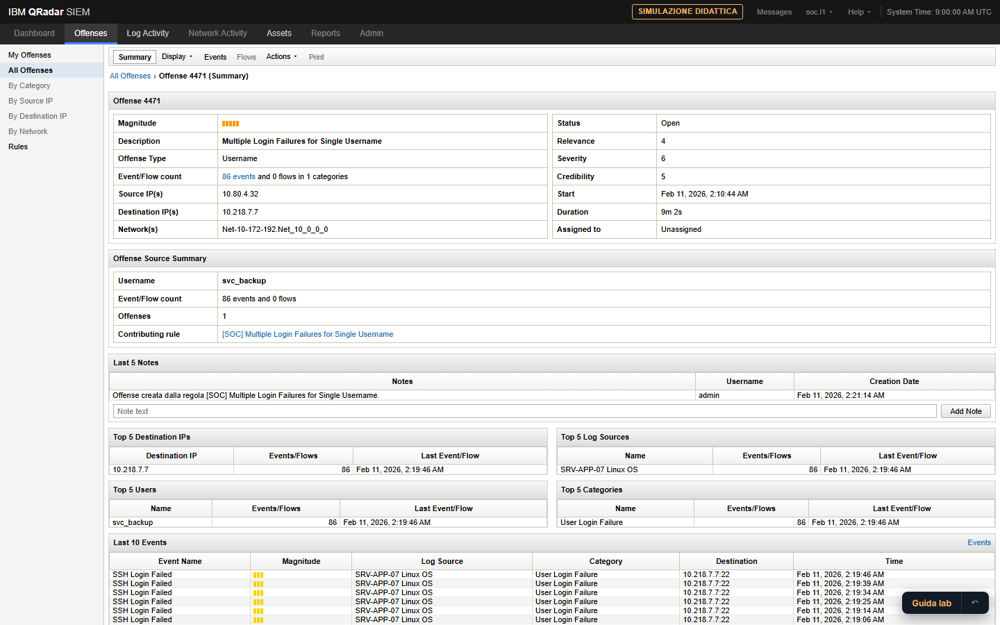

# Threat Hunting Range

Laboratorio per insegnare il triage ai nuovi analisti SOC. Sette console simulate, 31 casi da risolvere, dati interamente sintetici. Funziona nel browser, senza installare nulla.

- **Presentazione:** `index.html`
- **Demo funzionante:** `demo/index.html` (un solo file di circa 2 MB, apribile anche da disco)
- **Online:** https://maryeena.github.io/threat-hunting-range/ · [apri la demo](https://maryeena.github.io/threat-hunting-range/demo/)

## Che cosa contiene la demo

| Parte | Che cosa mostra | Dove |
|---|---|---|
| Preparazione | Il metodo di triage in sette unità con verifica | `demo/#/preparazione` |
| Guide alle piattaforme | Una guida pratica per console, con 54 esercizi svolti nel simulatore | `demo/#/piattaforme` |
| Catalogo | 31 scenari su identità, endpoint, rete, posta e casi a più console | `demo/#/catalogo` |
| Risultati | Stati, tentativi separati per modalità, resoconto esportabile | `demo/#/risultati` |

Console simulate: IBM QRadar, Splunk Enterprise Security, Microsoft Defender XDR, Trend Vision One, ExtraHop RevealX, CrowdStrike Falcon, SentinelOne Singularity.
Linguaggi: AQL, SPL, KQL, CQL, S1QL, ricerca di Trend, filtri di ExtraHop.

## Da dove viene

Il laboratorio è la parte pratica della SOC L1 Academy, il percorso di formazione che ho scritto per i nuovi analisti: un workflow di analisi comune a tutte le console, oltre venti manuali di piattaforma e guide dei casi, quattro giornate di corso con regia per il trainer, 25 assessment e 4 esercitazioni giornaliere.
L'Academy contiene dati di casi reali e resta materiale interno. Qui c'è il metodo, con ogni caso riscritto su dati sintetici.

## Come è costruito

- JavaScript senza framework né dipendenze; la pagina è autosufficiente e funziona senza rete (unico esterno: i caratteri tipografici).
- Un interprete per ogni linguaggio di query e un'interfaccia dedicata per ogni console, separata dal livello didattico.
- La risposta attesa di ogni esercizio è calcolata eseguendo l'operazione sul simulatore, non scritta nel codice.
- 2.000 controlli automatici in dodici serie di test, che risolvono ogni obiettivo e ogni esercizio sul simulatore.
- Contenuti, metodo, casi e criteri di verifica sono miei; il codice è stato sviluppato con l'assistenza di Claude Code.

## Pubblicazione

La cartella è un sito statico: si pubblica così com'è (per esempio con GitHub Pages, dalla radice del repository).
Prima di pubblicare, compilare l'oggetto `PROFILO` in fondo a `index.html` (nome, presentazione, LinkedIn, email, repository).

## Avvertenze

Simulazione didattica con dati sintetici: host, utenti, indirizzi ed eventi sono inventati.
Il progetto non è affiliato ai vendor citati; i nomi dei prodotti appartengono ai rispettivi proprietari e non sono usati loghi né materiale grafico originale.
